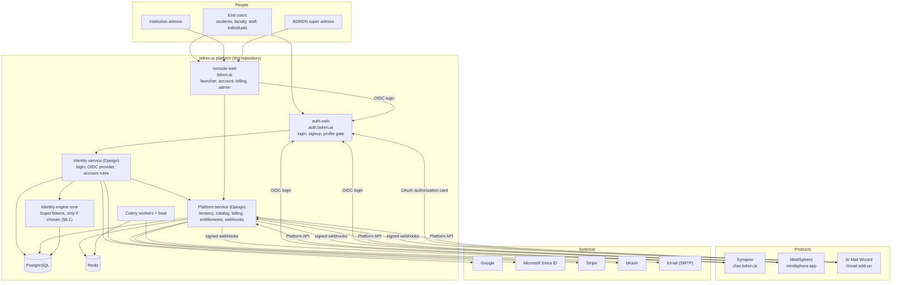
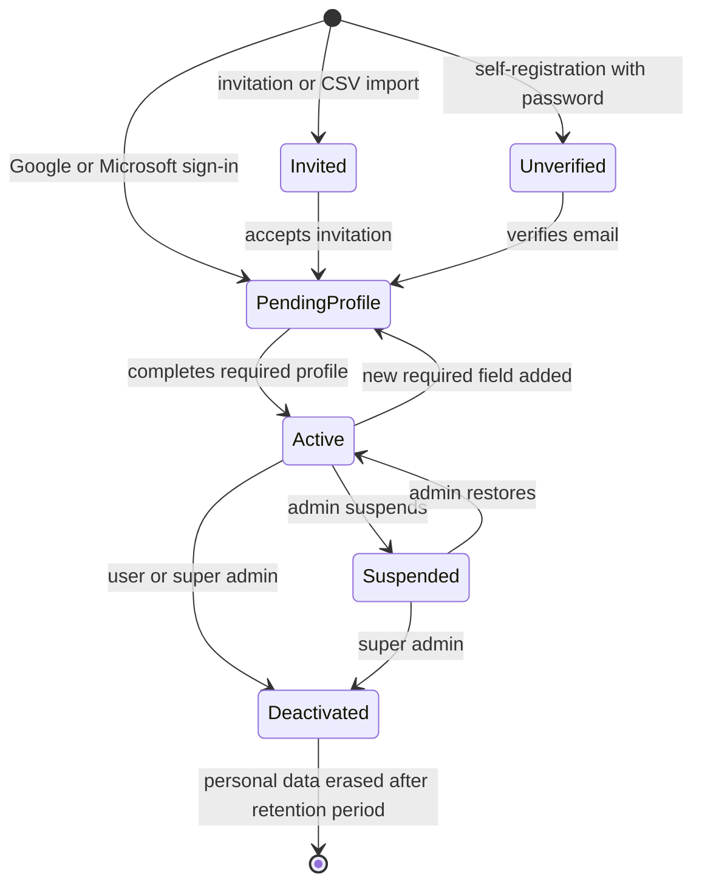
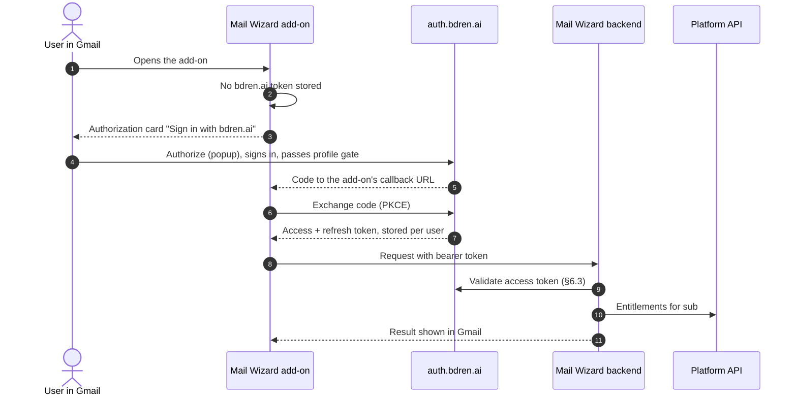
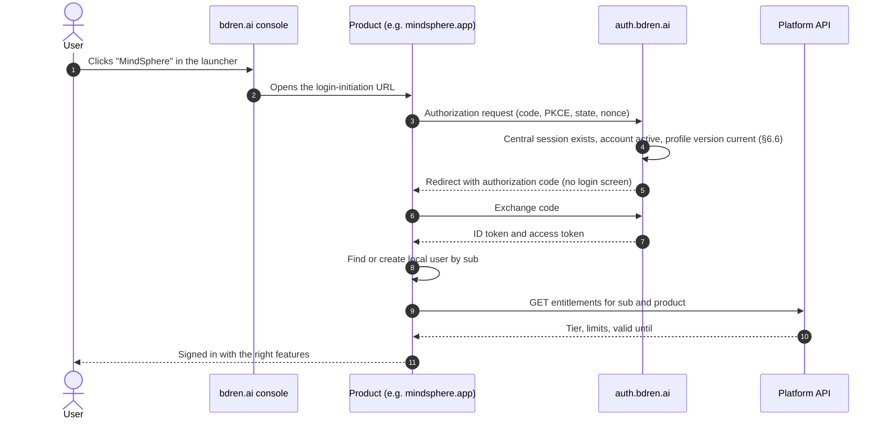
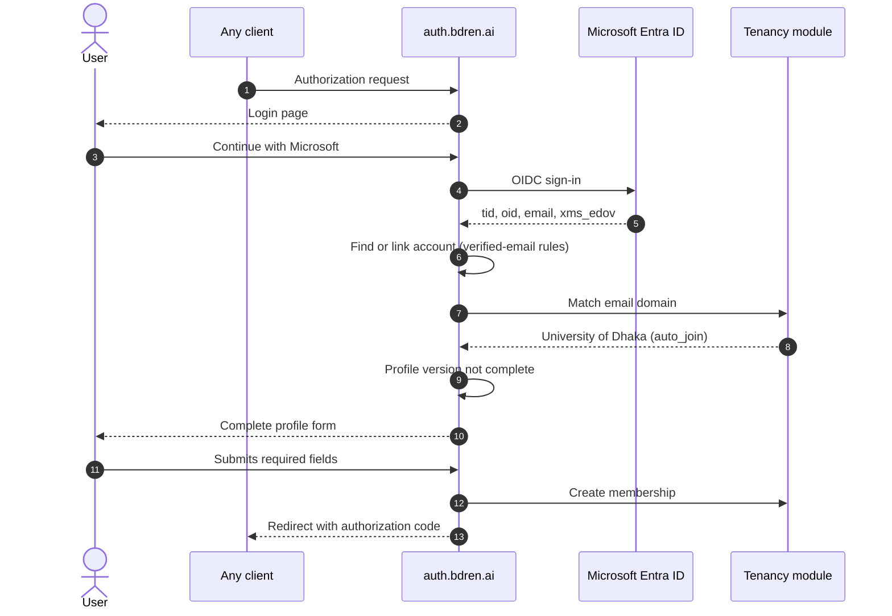
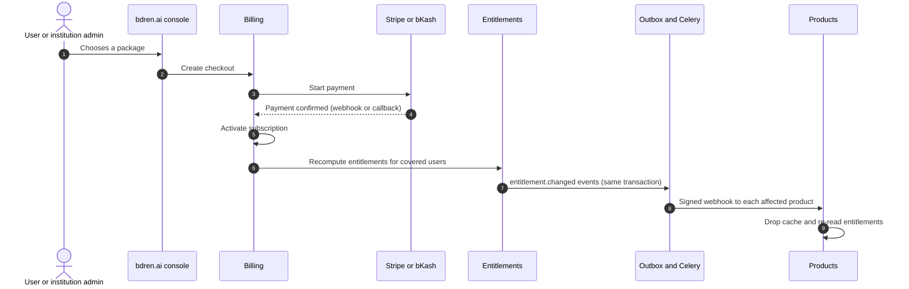
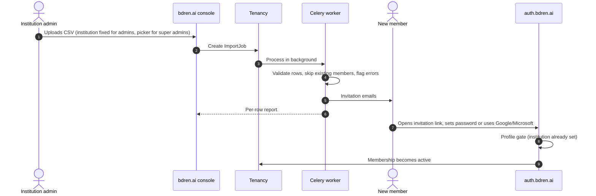

# bdren.ai — North Star Architecture

| | |
|---|---|
| **Status** | Draft v0.2, for team review (review fixes applied, see §16.1) |
| **Date** | 2026-11-10 |
| **Scope** | The bdren.ai platform (accounts, institutions, packages, payments, single sign-on) and the contract between it and every BDREN product |
| **Decisions so far** | No Keycloak. The identity engine is **reopened** (ADR-001): SuperTokens' docs say its OIDC provider (Unified Login) is available only on the managed service, which conflicts with keeping data in Bangladesh (Q6). Phase 0 chooses between the options in §6.1. |

---

## 0. How to use this document

This is the **target state**: what bdren.ai should look like when it's done. It is not a sprint plan. Phase, milestone and task plans come later and should:

- refer to section numbers here (for example "implements §8.4"), so every piece of work traces back to the North Star;
- change this document only through a decision record (§16). If a phase plan needs to break a rule here, write the decision first and then update this file.

Words like **must**, **should** and **may** are used deliberately. "Must" means a design that breaks it is wrong. "Should" means the default unless there's a written reason. "May" means optional.

---

## 1. Vision

**bdren.ai is the single front door to every AI product BDREN offers.** It plays the role openai.com plays for ChatGPT and the OpenAI platform: one account, one place to buy, one place to manage access.

- A person signs up **once** and uses MindSphere, Synapse, AI Mail Wizard and every future product with the same account.
- A university is onboarded **once**. Its admins manage their own people, and BDREN manages the institutions.
- A package is bought **once** and unlocks the right features in every product it covers, wherever that product is hosted.

```
                          ┌──────────────────────────────┐
                          │        auth.bdren.ai          │
                          │   one account, one sign-in    │
                          └──────────────┬───────────────┘
            ┌─────────────────┬──────────┴─────────┬──────────────────────┐
            ▼                 ▼                    ▼                      ▼
     bdren.ai console    chat.bdren.ai       mindsphere.app       AI Mail Wizard
  (accounts, institutions, (Synapse)          (MindSphere)        (Gmail add-on)
   packages, payments,
   app launcher)
```

---

## 2. Goals, non-goals and success measures

### 2.1 Goals

| # | Goal |
|---|---|
| G1 | One identity across all BDREN products, regardless of domain. |
| G2 | Institution-based user management: BDREN creates institutions; institution admins fully manage their members. |
| G3 | Open self-registration, with every user attached to an institution (or a pending "Other" request). |
| G4 | Google and Microsoft sign-in with institutional email, plus email/password. |
| G5 | A mandatory profile-completion gate that no product can bypass. |
| G6 | Packages that cover one product or many, bought by individuals or institutions, paid through Stripe or bKash. |
| G7 | Entitlement changes reach every product within a minute when the webhook is delivered, and within 5 minutes in the worst case (§8.4). |
| G8 | Adding a new product is a configuration and integration task, not a platform rewrite. |

### 2.2 Non-goals (for now)

- bdren.ai does not host product features. MindSphere's surveys, Synapse's chats and so on stay in their products.
- bdren.ai does not replace each product's own database. Products keep their data and link it to the bdren.ai user ID.
- A public developer platform with API keys and usage billing (like platform.openai.com) is a later horizon (§15), not part of the first build.

### 2.3 Success measures

| Measure | Target |
|---|---|
| Products using bdren.ai sign-in | 100% of BDREN products; no product-local passwords after migration |
| Time from purchase to features unlocked in a product | Under 60 seconds |
| Time to onboard a new institution (create, admin invited, domain set) | Under 15 minutes of super-admin work |
| Users with a complete profile | 100% of active users (enforced, not hoped for) |
| auth.bdren.ai availability | 99.9% monthly |

---

## 3. Guiding principles

These hold for every design decision. When a phase plan is unclear, these break the tie.

1. **One identity, many products.** Every person has exactly one bdren.ai account, identified by one stable ID (`sub`). Products never hold passwords or create sign-in identities of their own. They may keep a local user record for their own data, keyed by `sub` (§9.1).
2. **Standards at the boundaries.** Products talk to bdren.ai only through OpenID Connect / OAuth 2.0, a documented REST API, and signed webhooks. **Products must never import identity-engine SDKs (SuperTokens or any other) or read bdren.ai's database.** That keeps the identity engine replaceable without touching any product.
3. **The console is just another client.** bdren.ai's own console signs in through auth.bdren.ai exactly like MindSphere does. No back doors, so the SSO path is always tested.
4. **Gate at the door.** Rules that apply to everyone, such as email verification and profile completion, are enforced at auth.bdren.ai before any product receives a login. Products never have to re-check them.
5. **One writer per piece of data.** Each kind of data has exactly one owner that may change it (§10.2). Everyone else reads it or receives events.
6. **Entitlements are pulled; changes are pushed.** Products ask the Platform API what a user can do, and bdren.ai pushes a signed webhook whenever that changes. Tokens carry identity, not billing state.
7. **Institution-first, individual-friendly.** The data model is built around institutions, but an individual can still sign up, pay and use products without an institution sponsoring them.
8. **Secure by default.** PKCE on every client, MFA for every admin, short-lived tokens, audit logs on every admin action.
9. **Extend the boilerplate; don't rewrite it.** The existing billing, admin, branding and frontend code is the starting point (§14).

---

## 4. Product landscape

| Product | Domain / channel | Type | Integration style |
|---|---|---|---|
| **bdren.ai console** | `bdren.ai` | This repository | First OIDC client; owns accounts, institutions, packages, payments, launcher |
| **auth.bdren.ai** | `auth.bdren.ai` | This repository | The sign-in server (OIDC provider) |
| **Synapse** | `chat.bdren.ai` | Web app | OIDC client (confidential, server-side) |
| **MindSphere** | `mindsphere.app` | Web app on a separate domain | OIDC client (confidential, server-side) |
| **AI Mail Wizard** | Google Workspace Marketplace (Gmail add-on) | Add-on | Custom authorization card in the add-on (§9.4) |
| Future products | Any domain | Any | Same contract (§9) |

Because MindSphere lives on a different registrable domain, cookies cannot be shared between it and bdren.ai. **Single sign-on must therefore be redirect-based (OIDC), not cookie-based.** This is the main reason auth.bdren.ai exists as a separate sign-in server.

---

## 5. Target architecture

### 5.1 System context



### 5.2 Components and responsibilities

| Component | Hostname | Owns | Must not |
|---|---|---|---|
| **auth-web** (Next.js) | `auth.bdren.ai` | Login, registration, social sign-in buttons, email verification, password reset, profile completion, MFA screens, consent | Show billing or admin features |
| **Identity service** (Django role + identity engine, §6.1) | `auth.bdren.ai/api/...` | Login methods, account-linking rules, signup protection, the OIDC provider (clients, codes, tokens, signing keys, claims), enforcing the profile gate | Decide entitlements |
| **SuperTokens core** (only if §6.1 picks option A or B) | Internal only | Credentials, login methods, sessions, tenants | Be reachable from the internet |
| **console-web** (Next.js) | `bdren.ai` | Marketing pages, pricing, app launcher, account pages, institution admin, super admin | Handle passwords or social sign-in directly |
| **Platform service** (Django role) | `bdren.ai/api/...` (console) and `api.bdren.ai/v1` (products) | Institutions, memberships, invitations, imports, product catalog, packages, subscriptions, payments, entitlements, usage, webhooks, audit | Store credentials |
| **Celery workers + beat** | Internal | Email sending, CSV imports, webhook delivery, subscription expiry, payment reconciliation | |
| **PostgreSQL** | Internal | All persistent data (Django schema and SuperTokens schema kept separate) | |
| **Redis** | Internal | Cache, rate limits, Celery broker | Hold anything that can't be rebuilt |

### 5.3 Deployment topology

- **One Django codebase, two runtime roles.** The same project is deployed twice: `ROLE=identity` serves auth.bdren.ai's API, and `ROLE=platform` serves the console API and the Platform API. Each role loads only its own URLs and middleware. This keeps the sign-in server small and isolated without maintaining two codebases.
- **Separate cookies per host.** auth.bdren.ai session cookies are host-only, so bdren.ai (and everything else) can never read them.
- **SuperTokens core**, if §6.1 picks it, runs as its own container (it is a Java service) on the private network, with its own database schema. With option C there is no separate identity container.
- **Two Next.js apps** (auth-web, console-web) share one UI package so branding and components stay consistent. Early on they may run as one Next.js deployment with host-based routing, but the code must stay separated so they can split without rework.
- **Environments:** local, staging (`*.staging.bdren.ai`), production. Every product has a staging OIDC client pointing at staging auth.

### 5.4 Codebase layout (target)

```
bdrenai/
├── backend/                     Django project (modular monolith)
│   ├── bdrenai/                 settings, per-role URLconfs, middleware
│   ├── identity/                identity engine setup, OIDC provider, account linking, signup protection,
│   │                            profile gate, token claims  (grows out of accounts/)
│   ├── tenancy/                 institutions, domains, memberships, invitations, imports, "Other" requests
│   ├── catalog/                 products, product tiers, OIDC client registry, webhook endpoints
│   ├── billing/                 packages, subscriptions, seats, Stripe, bKash  (grows out of subscriptions/)
│   ├── entitlements/            entitlement resolver, Platform API, usage records
│   ├── events/                  outbox, webhook signing and delivery
│   └── audit/                   audit log (grows out of bdrenai/audit.py)
├── frontend/
│   ├── apps/auth-web/           auth.bdren.ai
│   ├── apps/console-web/        bdren.ai
│   └── packages/ui/             shared components, branding, theme
├── sdk/                         small helper libraries for products (Python, Node, Apps Script snippet)
└── docs/                        this file, decision records, integration guide
```

**Module rule:** modules talk to each other through service functions, never by writing each other's tables. This is what lets a module become its own service later if needed.

---

## 6. Identity and single sign-on (auth.bdren.ai)

### 6.1 Engine (ADR-001, reopened)

The first draft chose SuperTokens for everything, including its paid OIDC provider (Unified Login). Checking SuperTokens' docs on 2026-11-10 showed:

- **Unified Login (the OIDC provider) and machine-to-machine tokens are managed-service only.** The self-hosted core doesn't include them. SuperTokens' pricing page says both options have the same features, so this must be confirmed in writing, but plan as if the feature pages are right.
- **Account Linking and MFA are paid** on self-hosted too, each with a $100/month minimum. Multi-tenancy is priced on request.

Q6 assumes user data stays in Bangladesh or on BDREN infrastructure, so the managed service is unlikely to be acceptable. Phase 0 (§6.2) therefore picks one of these:

| Option | Login, linking, MFA, sessions | OIDC provider and machine-to-machine tokens | Trade-offs |
|---|---|---|---|
| **A** | SuperTokens, managed service | SuperTokens Unified Login | Only if V2 (data location) is acceptable. SuperTokens tells resource servers to validate its tokens with its SDK, which products can't do (principle 2), so plain-JWT validation must be proven. |
| **B** | SuperTokens, self-hosted, through supertokens-python | django-oauth-toolkit | Two user stores (SuperTokens and Django) kept in step by a provisioning job. Needs a bridge so the OIDC provider treats a SuperTokens session as a Django login. Account Linking and MFA licences. |
| **C** | django-allauth (headless API for auth-web) | django-oauth-toolkit, or allauth's own OIDC provider | One user table and Django's own login, so no bridge and no licences. The account-linking rules, Microsoft `tid` + `oid` keying and admin MFA must be proven in the spike. |

Only §6.1, §6.5 and §9.5 depend on the choice. Everything products see (§6.3 onward) is the same under all three.

**What the identity engine owns vs what Django owns** (with option C both columns live in Django, in different modules):

| Identity engine | Django (bdren.ai) |
|---|---|
| Passwords and password hashes | User profile (name, phone, designation, avatar, user type) |
| Login methods and linked Google/Microsoft accounts | Profile-completion state and required-field rules |
| Email verification status | Institutions, memberships, roles |
| Sessions on auth.bdren.ai | Products, packages, subscriptions, entitlements |
| OIDC provider: clients, codes, access/refresh tokens, signing keys | Invitations, imports, "Other" requests |
| Per-institution login configuration, if any (§6.5) | Audit log, webhooks |

**The `sub`.** Every token's `sub` is the Django `User.id` (a UUID), so existing boilerplate user IDs survive unchanged. The `sub` never changes, including after account linking. With django-oauth-toolkit this is the default, because `sub` is the user's primary key. With SuperTokens, the Django UUID is attached through user ID mapping. That spans two databases, so it runs as a retryable provisioning job:

1. create (or find) the SuperTokens user;
2. create (or find) the Django `User`;
3. map the SuperTokens user to the Django UUID;
4. mark provisioning complete.

Every step is safe to run again. A failure leaves the account in a "provisioning" state that a reconciliation job finishes. It must never create a second account.

**If SuperTokens is used (options A and B):**

| Need | SuperTokens recipe | Availability |
|---|---|---|
| Email/password sign-up, sign-in, password reset | EmailPassword | Free |
| Google, Microsoft, LinkedIn sign-in | ThirdParty (built-in providers) | Free |
| Email verification | EmailVerification | Free |
| Sessions on auth.bdren.ai | Session | Free |
| Being the OIDC provider for other domains | OAuth2Provider ("Unified Login") | **Managed service only** |
| Machine-to-machine tokens | M2M (client credentials) | **Managed service only** |
| One account across Google + Microsoft + password with the same email | AccountLinking | **Paid** (licence key when self-hosted) |
| TOTP for admins | MultiFactorAuth + TOTP | **Paid** |
| Institution-specific login providers (campus SSO, SAML) | Multitenancy | **Paid** |
| Keeping the existing Django user UUIDs as the public user ID | User ID mapping | Not listed as paid |

### 6.2 Phase 0 verification gate

**SuperTokens questions.** The table records what SuperTokens' docs said on 2026-11-10. SuperTokens' pricing page and feature pages disagree, so **any answer the choice depends on must be confirmed in writing with SuperTokens.**

| # | Question | Docs on 2026-11-10 | Consequence |
|---|---|---|---|
| V1 | Is Unified Login (OAuth2Provider) available on self-hosted core with a licence key? | **No**, managed service only. | Option A only if V2 passes; otherwise B or C. |
| V2 | If managed: which region hosts the data, and is that acceptable for BDREN and its institutions? | Open. Conflicts with Q6's working assumption. | If not acceptable, option A is out. |
| V3 | Does the Python SDK support OAuth2Provider? | **Yes** (Node.js and Python). | — |
| V4 | Can a custom login UI (not the prebuilt React UI) drive the OAuth2 login flow (`loginChallenge`)? | Open. The redirect override is documented for Node.js only. | Option A only. |
| V5 | Can the backend refuse to continue an OAuth2 login until the profile is complete? | Open. | Option A only. In B and C our own authorization view enforces it (§6.6). |
| V6 | Does OAuth2Provider support OIDC back-channel logout? | Not documented (nor for django-oauth-toolkit or allauth). | Products are told through our own webhook (§6.7). |
| V7 | Is the `client_credentials` grant available for machine-to-machine tokens? | **No** on self-hosted (managed service only). | In B and C, django-oauth-toolkit issues them (§9.2). |
| V8 | Price at our expected scale for Account Linking, MFA and Multitenancy (plus Unified Login for option A). | Account Linking $0.005 and MFA $0.01 per monthly active user, each with a $100/month minimum. The rest on request. | Budget input to the choice. |
| V9 | With user ID mapping in place, do OAuth2 tokens carry the mapped (Django) user ID as `sub`, including after account linking? | Not documented. | Option A only. In B and C the provider is ours. |

**Spike tests.** Options B and C (and A, if V2 passes) run the same tests. The option that passes them with the least custom code wins, and ADR-001 records the result.

| # | Test | Passes when |
|---|---|---|
| S1 | Login methods | Password, Google and Microsoft sign-ins resolve to one account under the §6.4 rules. Microsoft is keyed by `tid` + `oid`. |
| S2 | OIDC basics | Authorization code + PKCE gives a valid ID token. Discovery, JWKS and UserInfo work. |
| S3 | Cross-domain SSO | After signing in on bdren.ai, a test app on another domain signs in with no second login. |
| S4 | Profile gate | A user whose account isn't active, or whose profile is incomplete or out of date, never gets an authorization code or a refreshed token, even with an existing central session (§6.6). |
| S5 | Stable identity | Every test client receives the same `iss` + `sub`, before and after linking a new login method. |
| S6 | Machine-to-machine | A product backend gets a client-credentials token that only works for its own product (§9.2). |
| S7 | Refresh tokens | Rotation, reuse detection, idle expiry, and revocation on password change and suspension all work (§6.3). |
| S8 | Logout | Logging out on one device ends that session in every test client and leaves other devices signed in. "Sign out everywhere" ends all of them (§6.7). |
| S9 | Admin MFA | TOTP is required for admins, and step-up works for a sensitive console action. |
| S10 | Gmail add-on | The custom authorization card flow works on the runtime chosen for Q3 (§9.4). |
| S11 | Conformance | The OpenID Foundation Basic OP and RP-Initiated Logout test plans pass, with any accepted deviations written down. |
| S12 | Failure recovery | The system recovers from an auth database outage, a worker outage and a missed webhook (§8.4, §13). |

Products only speak standard OIDC (principle 2), so the choice changes auth.bdren.ai's internals but **not a single product**.

### 6.3 The OIDC contract

This contract is what products depend on. It must not change without a decision record.

**Discovery.** Products configure only the issuer `https://auth.bdren.ai` and read every endpoint from its OpenID discovery document. Endpoint paths are never hard-coded.

**Client types:**

| Client | Type | Grant | Notes |
|---|---|---|---|
| bdren.ai console | Confidential (server-side) | Authorization code + PKCE | Platform role exchanges the code and issues its own console session cookie |
| Synapse, MindSphere | Confidential (server-side) | Authorization code + PKCE | Tokens stay on the product's server, never in browser storage |
| AI Mail Wizard | Confidential (Apps Script / add-on backend) | Authorization code + PKCE, refresh tokens | §9.4 |
| Product backends calling the Platform API | Confidential | Client credentials | One per product (for example `synapse-platform`), separate from its sign-in client and limited to its own product (§9.2) |

**Rules for every client:** exact redirect-URI matching; PKCE required; no implicit or password grants; `state` and `nonce` always checked.

**Scopes:**

| Scope | Grants |
|---|---|
| `openid` | `sub` |
| `profile` | Name, picture, designation, user type |
| `email` | `email`, `email_verified` |
| `institution` | The `institution` claim |
| `offline_access` | Refresh token (only for clients that need it, such as the add-on) |

**bdren.ai claims** (added by Django overrides; present in the ID token and access token when the scope allows):

| Claim | Example | Meaning |
|---|---|---|
| `sub` | `"3f1c…"` | Stable bdren.ai user ID (Django `User.id`) |
| `institution` | `{"id": "…", "name": "University of Dhaka", "role": "member", "status": "active"}` | Primary institution, or `null` |
| `user_type` | `"faculty"` | Student, faculty, staff, researcher, other |
| `platform_role` | `"super_admin"` | Only present for BDREN staff roles |
| `profile_complete` | `true` | Always true in tokens issued to clients (the gate guarantees it) |

**Not in tokens:** packages, subscriptions, limits. Those come from the Platform API (principle 6), because tokens can't be updated after they are issued.

**Claims are a snapshot.** `institution`, `user_type` and `platform_role` are correct when the token is issued. Products may use them for display and defaults, but must not decide admin or institution permissions from them. They read the current state from the Platform API (`GET /users/{sub}`).

**Access tokens.** Phase 0 fixes one access-token format, and every resource server validates tokens only that way:

- **JWT:** check the signature against JWKS, plus `iss`, `aud`, `exp` and the token type, so an ID token can never be used as an access token; or
- **Opaque:** call the provider's introspection endpoint (RFC 7662) with the product's own credentials.

The product SDK (§9.6) does this, so products don't each implement it. A JWT checked locally stays valid until it expires (up to 10 minutes), even after revocation. A product that needs an instant cut-off uses introspection.

**Token lifetimes (initial targets, tune after launch):**

| Token / session | Lifetime |
|---|---|
| Access token | 10 minutes |
| ID token | 10 minutes (used once at login) |
| Refresh token | Rotating with reuse detection. Expires after 30 days unused. Revoked on reuse, password change, suspension, deactivation and "sign out everywhere" |
| auth.bdren.ai session | 12 hours idle, 30 days absolute with "remember me" |
| Product sessions | Product's choice, but must end on logout events (§6.7) |

Every value here is **set explicitly** and covered by a test. Framework defaults are not trusted: for example, django-oauth-toolkit by default issues 10-hour access tokens, never expires refresh tokens, leaves reuse protection off and stores tokens in plain text.

### 6.4 Login methods and account linking

| Method | Notes |
|---|---|
| Email + password | Email verification is required before the profile gate. |
| Google | Workspace accounts carry an `hd` (hosted domain) claim. It is used for institution matching only when it equals a domain BDREN has verified for that institution (§7.3). |
| Microsoft (Entra ID, multi-tenant) | Identify users by `tid` + `oid`, not by email. Treat the email as verified only when Microsoft sends `xms_edov=true`; otherwise send our own verification email. |
| LinkedIn | Optional, off by default (open question Q5). |
| Institution's own IdP (SAML or OIDC) | Later horizon, through a per-institution login configuration (§6.5). |

**Account linking rules** (implemented in the identity engine's linking hooks, carried over from the boilerplate's `resolve_social_login` logic):

1. A new sign-in method links automatically to an existing account **only** if both sides have a verified email that matches.
2. If either email is unverified, the user must prove ownership (verify the email, or sign in with the existing method first) before linking.
3. Linking never merges two accounts that both already hold subscriptions or memberships; that needs a super-admin merge tool.
4. Linking never changes the account's `sub`. The existing account's ID is kept.

### 6.5 Institution-specific login (later horizon)

Institutions are a business concept and live in Django (§7). An identity engine's tenants are only for **login configuration**, never for modelling membership, admins, invitations or seats. In SuperTokens, for example, each tenant has its own user pool and its own login methods.

- **All users live in one pool by default** (in SuperTokens, the `public` tenant). The first release has no institution-specific login configurations.
- **An institution gets its own login configuration only when it needs one**, for example:
  - signing in through the university's own Microsoft tenant or SAML IdP (campus SSO);
  - forcing a specific login method for that institution's members;
  - an institution-branded login page.
- `Institution.auth_tenant_id` links the two. auth-web asks for the email first and maps the domain to an institution. If that institution has its own login configuration, auth-web shows those options.
- **One person, one `sub`, whichever login configuration they use.** This doesn't happen automatically. In SuperTokens the same email in two tenants becomes two different users, and sessions are per tenant. Before any institution gets its own configuration, the design must add an explicit step that attaches the existing account to it (or links the new login method to the account), and S5 (§6.2) must pass with it.

### 6.6 Profile-completion gate

**Rule:** no client, including the console, receives an authorization code or a refreshed token for a user whose account isn't active or whose profile is incomplete.

- **Checked on every request, from the database.** On every authorization request, before a code is issued, the identity service reads the user's current state: account active, email verified, and `profile_version_completed` equal to the current required-profile version. A `profile_complete` session claim may cache this for the UI, but it never makes the decision.
- **The same check runs on refresh-token requests.** If it fails, the client gets an error and sends the user through authorization again, which shows the gate.
- When the check fails during authorization, auth-web sends the user to `/complete-profile` and then resumes the original authorization request.
- The required fields are configured by super admins. Initial set:
  - first name, last name
  - institution (from the dropdown) **or** "Other" plus a free-text name
  - user type (student, faculty, staff, researcher, other)
  - designation
  - phone (required or optional, configurable)
  - acceptance of the terms and privacy policy
- **Profile schema versions:** if a super admin adds a new required field, the version goes up. Every user goes through the gate again at their next authorization or token refresh, even if they already have a central session.
- **Console guard as a second layer:** the console API also refuses everything except `/me/profile` endpoints for incomplete profiles, in case a session predates a schema change.

### 6.7 Sessions, logout and MFA

- **The Logout button means single logout.** Logging out of any product sends the user to auth.bdren.ai's end-session endpoint (OIDC RP-Initiated Logout). That ends the central session on that browser and every product session created from it. Products may also offer "sign out of this product only", which ends just their local session.
- **How products find out.** None of the candidate engines documents OIDC back-channel logout, so products are told through the signed `user.sessions_revoked` webhook (§9.3). It is retried until delivered, so a product that is briefly offline still catches up.
  - The ID token carries a central session ID (`sid`). Products store it with each local session.
  - After a single logout, the event carries that `sid`, and products end only the sessions created under it. The user stays signed in on their other devices.
  - After "sign out everywhere", a password change, suspension or deactivation, the event has no `sid`, and products end all of that user's sessions.
- **Admin actions:** "sign out everywhere", suspension and deactivation revoke all refresh tokens and notify all products.
- **MFA:** required for super admins and institution admins (TOTP to start, passkeys later). Members may turn it on.
- **Step-up:** sensitive console actions (changing prices, appointing admins, bulk deletes) require a recent MFA check.

---

## 7. Tenancy and user management

### 7.1 Hierarchy

```
BDREN (platform owner, super admins)
 ├── University of Dhaka            ← institution
 │    ├── Institution admins        ← e.g. ICT director
 │    └── Members                   ← students, faculty, staff
 ├── University of Rajshahi
 │    └── …
 └── Individuals with no sponsoring institution (or a pending "Other" request)
```

- **Super admin** is a *platform role*, not an institution role. BDREN staff may also be members of a "BDREN" institution like anyone else.
- **One primary institution per user** to start (ADR-007). The schema allows several memberships so this can be relaxed later without a migration.

### 7.2 Roles and permissions

| Capability | Super admin | Institution admin | Member |
|---|---|---|---|
| Create, edit, suspend institutions | Yes | Edit own profile only | — |
| Add or verify institution email domains | Yes | Request only | — |
| Invite, create or CSV-import members | Any institution (institution picker) | Own institution | — |
| Appoint or remove institution admins | Yes | Own institution (configurable) | — |
| Suspend or remove members | Yes | Own institution | — |
| View members and usage | All | Own institution | Own |
| Review "Other" institution requests | Yes | — | — |
| Manage products, packages, prices | Yes | — | — |
| Buy packages | Yes | For own institution | For self |
| Assign institution seats | Yes | Own institution | — |
| Manual entitlement grants (trials, complimentary access) | Yes | — | — |
| Platform settings (signup policy, providers, required fields, branding) | Yes | — | — |
| Audit log | All | Own institution | Own activity |

**Implementation rule:** one permission check, `can(actor, action, institution)`, used by every console endpoint. Super admins pass for any institution; institution admins only for their own. The same screens serve both, with the institution picker shown only to super admins.

### 7.3 Ways a user gets in

| Path | Steps | Institution |
|---|---|---|
| **Invitation** | Admin invites by email → user opens link → sets a password or uses Google/Microsoft → profile gate | Set by the invitation |
| **CSV import** | Admin uploads CSV (email, names, user type, role) → background job validates → creates pending accounts and sends invitations → admin gets a per-row report | Chosen at upload (super admins pick it) |
| **Admin creates directly** | Same as invitation, but the admin fills in the profile; the user still sets their own password | Chosen by the admin |
| **Self-registration** | auth.bdren.ai sign-up → email verification → profile gate with institution dropdown or "Other" | Selected, or pending "Other" request |
| **Google / Microsoft** | Sign in → email domain matched to an institution → profile gate | Matched by domain, or selected |

**Email-domain policy** (per institution domain, set by super admins after verifying the domain):

| Policy | Effect |
|---|---|
| `auto_join` | A verified email at this domain becomes a member automatically. |
| `approval` | The user is suggested this institution; an institution admin approves. |
| `off` | Domain is recorded but not used for matching. |

### 7.4 "Other" institution requests

1. The user picks "Other" and types a name. Their account becomes active as an **individual** with a pending request.
2. Super admins see a review queue, with similar existing institutions suggested by name and email domain.
3. A super admin either **approves** (creates the institution; the user joins it), **merges** (attaches the user to an existing institution), or **rejects**.
4. Until the request is resolved, the user can use free tiers and anything they buy for themselves, but nothing an institution sponsors.

### 7.5 User lifecycle



Every transition writes an audit entry and, where products care (suspension, deactivation, profile changes), emits a webhook.

---

## 8. Packages, billing and entitlements

### 8.1 Concepts

| Concept | Meaning | Example |
|---|---|---|
| **Product** | Something BDREN offers, with its own domain and OIDC client | MindSphere |
| **Product tier** | A level of access the product itself understands, with default limits | `mindsphere:pro` with `{"surveys": 25, "responses_per_month": 10000}` |
| **Package** | What is sold. Contains one or more product tiers, optionally with overridden limits | "MindSphere Pro" (one product) or "All-Access Pro" (MindSphere Pro + Synapse Pro + Mail Wizard Pro) |
| **Subscription** | A package held by a **user** or an **institution**, for a billing period | University of Dhaka holds "All-Access Pro" for 500 seats |
| **Seat** | One user covered by an institution's subscription | Dr. X uses one of Dhaka's 500 seats |
| **Entitlement** | The effective result for one user and one product | User X → MindSphere `pro`, limits {…}, valid until 2027-06-30, source: institution |

Each product registers its tier vocabulary in the catalog. bdren.ai never needs to understand what a "survey" is; it just passes the limits through.

### 8.2 Entitlement resolution

For user **U** and product **P**, collect every source:

1. U's own active subscriptions that include P;
2. institution subscriptions that cover U (all members, or an assigned seat);
3. manual grants by super admins (with expiry);
4. P's free tier, if the product has one.

**The highest-ranked tier wins**, and its limits apply as a whole (limits are not mixed across sources). The result records which source granted it, so support can answer "why does this user have Pro?".

Subscription states that still grant access: `active`, `trialing`, `past_due` within the grace period, and `canceled` until the period ends. `expired` and `suspended` do not.

### 8.3 Payments

| Method | Use | Status in boilerplate |
|---|---|---|
| Stripe | International cards, USD, recurring | Exists (checkout, webhooks, portal) |
| bKash | Local payments, BDT | Exists (tokenized checkout, callbacks, refunds, SNS) |
| Manual invoice | Institutions paying by purchase order or bank transfer | New: super admin records payment, subscription activates |

Prices are stored per package per currency and billing cycle. The payment provider only confirms payment; **bdren.ai's subscription record is the source of truth** for access.

### 8.4 Propagation to products

```
change happens ──► entitlements recomputed ──► outbox event (same DB transaction)
                                                    │
                                                    ▼
                                       Celery delivers signed webhook
                                                    │
                                                    ▼
                         product drops its cache and re-reads the Platform API
```

- **Pull:** products call `GET /v1/entitlements/{sub}?product={slug}` and may cache the answer for up to 5 minutes.
- **Push:** every change emits `entitlement.changed` to each affected product.
- **Safety net:** if a webhook is missed, the 5-minute cache limit bounds how stale a product can be. Products may also call a bulk "changed since" endpoint to reconcile.
- **Revocations don't wait for the cache.** Suspension and deactivation also send `user.suspended` / `user.deactivated`, products end the user's sessions, and the profile gate (§6.6) blocks new tokens.
- **Target:** under 60 seconds from payment confirmation to features unlocked when the webhook is delivered (success measure §2.3), and 5 minutes at worst if it is missed.

### 8.5 Usage and limits

- **Products enforce their own limits** using the limits in the entitlement. bdren.ai doesn't sit in the request path of product features.
- **Products report usage** (`POST /v1/usage`, idempotent) so users and institution admins see usage in the console.
- **Shared credit pools** across products (for example one AI-credit balance) are a later option (§15). The usage API is designed so this can be added without changing products' reporting calls.

---

## 9. Product integration contract

### 9.1 What every product must do

1. **Register** in the catalog: slug, name, launch URL, login-initiation URL, redirect URIs, webhook URL, tier vocabulary.
2. **Sign users in only through auth.bdren.ai** (authorization code + PKCE, server-side code exchange).
3. **Key its users by `iss` + `sub`.** The product may create a local user record on first login (just-in-time) to hold its own data, storing `bdren_iss` and `bdren_sub` with a unique constraint on the pair. The record never has a password or any other way to sign in.
4. **Support login started from the launcher:** opening the login-initiation URL must start the OIDC flow immediately.
5. **Read entitlements from the Platform API** and apply them; never store prices or plans locally.
6. **Accept and verify webhooks** (signature, timestamp, idempotency by event ID).
7. **Report usage** for metered features.
8. **Handle logout:** store the ID token's `sid` with each local session. On `user.sessions_revoked`, end the matching sessions, or all of the user's sessions when the event has no `sid` (§6.7).
9. **Remove local passwords** after migration (§9.5).
10. **Validate access tokens** only by the method fixed in §6.3, if the product accepts bdren.ai access tokens (as Mail Wizard's backend does).

### 9.2 Platform API (`https://api.bdren.ai/v1`)

Authenticated with client-credentials tokens from auth.bdren.ai. Each product has its own platform client (for example `synapse-platform`, `mindsphere-platform`, `mailwizard-platform`), separate from its sign-in client. A client's token works only for its own product: the API rejects a `product` parameter or usage record that belongs to another product. These tokens are never accepted where a user's token is expected, or the other way round.

| Endpoint | Scope | Purpose |
|---|---|---|
| `GET /users/{sub}` | `users:read` | Profile and institution (for products that need more than the token) |
| `GET /entitlements/{sub}?product={slug}` | `entitlements:read` | Effective tier, limits, validity, source |
| `GET /entitlements?product={slug}&changed_since={ts}` | `entitlements:read` | Bulk reconciliation |
| `POST /usage` | `usage:write` | Usage records with an idempotency key |
| `GET /institutions/{id}` | `institutions:read` | Institution details |

Rules: JSON only, versioned URL, cursor pagination, idempotency keys on every POST, rate limits per client.

### 9.3 Webhook events

Delivery follows the **Standard Webhooks** format (`webhook-id`, `webhook-timestamp`, `webhook-signature` headers, HMAC-SHA256, per-product secret). Delivery is at-least-once, retried with exponential backoff for 24 hours, then flagged in the console.

| Event | When |
|---|---|
| `entitlement.changed` | A user's effective entitlement for this product changed |
| `user.updated` | Name, email, picture, user type or institution changed |
| `user.suspended` / `user.reactivated` | Admin suspension or restore |
| `user.deactivated` | Account closed; product should anonymise or delete per policy |
| `user.sessions_revoked` | Single logout (carries the central `sid`), or sign out everywhere, password change, security event (no `sid`: end all sessions) |
| `membership.changed` | User joined, left, or changed role in an institution |
| `institution.updated` | Institution renamed, suspended, etc. |

### 9.4 Per-product notes

**Synapse (chat.bdren.ai).** Same parent domain, so the simplest integration and the **first product to onboard**. Still uses full OIDC (no shared-cookie shortcuts), so the pattern is identical for every later product.

**MindSphere (mindsphere.app).** Standard OIDC client on a separate domain. The first true test of cross-domain SSO.

**AI Mail Wizard (Gmail add-on).** Add-ons can't do a normal redirect login. Google's documented approach for non-Google services is an **authorization card**:



Two separate authorizations are involved, and neither replaces the other:

- **Google:** the Google scopes the add-on requests (for example, reading the open message). Google handles this consent.
- **bdren.ai:** the sign-in above, which identifies the user and lets Mail Wizard's backend check their entitlement. The bdren.ai token never grants Google access, and a Google token never identifies a bdren.ai user.

Google's rules for the card: a publicly published add-on **must use a custom authorization card**, every link it opens must use HTTPS, and the sign-in button must reload the add-on when it closes (`OnClose.RELOAD`).

If the add-on is built on Apps Script, the OAuth2 for Apps Script library handles the flow and the callback is the script's `usercallback` URL. If it uses an HTTP runtime with its own backend, the backend plays the client role instead. Which applies is an open question (Q3). The OAuth client registration (who holds the client secret, which redirect URI) waits for that answer.

### 9.5 Migrating existing product users

1. **Inventory** each product's users (count, login methods, password hash format).
2. **Import** into the identity engine.
   - With SuperTokens (options A and B): bcrypt, Argon2 and Firebase scrypt hashes import directly. **Django's default PBKDF2 hashes are not on SuperTokens' supported list**, so for Django-based products use **lazy migration**: on first login, an override checks the password against the old hash and then saves it in SuperTokens.
   - With option C: Django's built-in hashers verify PBKDF2, bcrypt and Argon2, so those hashes import by rewriting them into Django's `algorithm$…` format. Anything else uses lazy migration.
3. **Match** accounts across products by verified email into one bdren.ai account; conflicts (same email, clearly different people) go to a manual review list.
4. **Link** each product's local user to its `sub` (`bdren_sub` column, backfilled).
5. **Cut over:** the product's login button goes to SSO; local login stays available for a short grace period, then is removed.

### 9.6 Product SDK

A small helper library (`sdk/`) for Python and Node.js, plus an Apps Script snippet:

- OIDC client setup from the issuer URL;
- entitlement lookup with caching;
- webhook signature verification;
- usage reporting with idempotency keys.

This keeps every product integration consistent and short.

---

## 10. Data model

### 10.1 Entities

```mermaid
erDiagram
  USER ||--o{ MEMBERSHIP : has
  INSTITUTION ||--o{ MEMBERSHIP : has
  INSTITUTION ||--o{ INSTITUTION_DOMAIN : owns
  INSTITUTION ||--o{ INVITATION : issues
  INSTITUTION ||--o{ IMPORT_JOB : runs
  USER ||--o{ INSTITUTION_REQUEST : submits
  PRODUCT ||--o{ PRODUCT_TIER : defines
  PRODUCT ||--o{ OAUTH_CLIENT : "signs in through"
  PRODUCT ||--o{ WEBHOOK_ENDPOINT : receives
  PACKAGE ||--o{ PACKAGE_ITEM : contains
  PRODUCT_TIER ||--o{ PACKAGE_ITEM : "included as"
  PACKAGE ||--o{ PACKAGE_PRICE : "priced as"
  PACKAGE ||--o{ SUBSCRIPTION : "sold as"
  USER |o--o{ SUBSCRIPTION : holds
  INSTITUTION |o--o{ SUBSCRIPTION : holds
  SUBSCRIPTION ||--o{ SEAT : allocates
  USER ||--o{ SEAT : occupies
  SUBSCRIPTION ||--o{ PAYMENT : "paid by"
  USER ||--o{ ENTITLEMENT_GRANT : receives
  USER ||--o{ ENTITLEMENT : "resolved to"
  PRODUCT ||--o{ ENTITLEMENT : "resolved for"
  USER ||--o{ USAGE_RECORD : generates
  PRODUCT ||--o{ USAGE_RECORD : meters
  OUTBOX_EVENT ||--o{ WEBHOOK_DELIVERY : "delivered as"
  USER ||--o{ AUDIT_ENTRY : "acts in"
```



Key fields (indicative, not final):

| Entity | Key fields |
|---|---|
| `User` | `id` (UUID = `sub`), `email`, `first_name`, `last_name`, `phone`, `designation`, `user_type`, `avatar`, `status`, `platform_role`, `profile_version_completed`, `created_at` |
| `Institution` | `id`, `name`, `short_name`, `slug`, `type`, `country`, `website`, `logo`, `status`, `source` (created by BDREN / from request), `auth_tenant_id` (nullable) |
| `InstitutionDomain` | `institution`, `domain`, `verified_at`, `policy` (`auto_join` / `approval` / `off`) |
| `Membership` | `user`, `institution`, `role` (`admin` / `member`), `status`, `is_primary`, `joined_at` |
| `Invitation` | `email`, `institution`, `role`, `token_hash`, `expires_at`, `invited_by`, `status`, `source` (manual / CSV) |
| `ImportJob` | `institution`, `file`, `created_by`, `status`, `rows_total`, `rows_ok`, `errors` |
| `InstitutionRequest` | `user`, `proposed_name`, `email_domain`, `status`, `resolved_institution`, `reviewed_by` |
| `Product` | `slug`, `name`, `launch_url`, `initiate_login_url`, `icon`, `status`, `has_free_tier` |
| `ProductTier` | `product`, `key`, `rank`, `default_limits` (JSON) |
| `Package` | `name`, `slug`, `audience` (individual / institution / both), `is_public`, `features` (display) |
| `PackageItem` | `package`, `product_tier`, `limit_overrides` (JSON) |
| `PackagePrice` | `package`, `currency` (USD / BDT), `cycle`, `amount`, provider price IDs |
| `Subscription` | `user` (nullable foreign key), `institution` (nullable foreign key; exactly one of the two is set), `package`, `status`, `cycle`, `seats`, `coverage` (all members / assigned seats), period dates, provider IDs |
| `Entitlement` | `user`, `product`, `tier`, `limits`, `valid_until`, `source_type`, `source_id` (a cached, recomputable result) |
| `OutboxEvent` | `id`, `type`, `payload`, `created_at`, `published_at` |

**Enforced by the database, not just application code:**

- one holder per subscription (check constraint);
- one seat per user per subscription;
- at most one primary membership per user;
- one `Entitlement` row per user and product;
- unique payment-provider event IDs, so a repeated payment webhook is ignored.

Entitlement recomputation is idempotent: running it twice gives the same rows and emits no duplicate events.

### 10.2 Who writes what

| Data | Single writer | Read by |
|---|---|---|
| Credentials, login methods, sessions, OAuth tokens | Identity engine and OIDC provider (via identity service) | — |
| Email address and its verification | Identity service, which handles every change. With SuperTokens it updates both stores through a retryable job with a reconciliation check | Platform (synced into `User`) |
| Profile fields | Identity service (gate) and console `/me/profile` (same module) | Everyone through claims, API, webhooks |
| Institutions, domains, memberships, invitations | `tenancy` | Identity (claims, matching), products (API, webhooks) |
| Products, tiers, clients | `catalog` | Everyone |
| Packages, subscriptions, seats, payments | `billing` | `entitlements` |
| Entitlements | `entitlements` (computed) | Products (API), console |
| Usage | Products (via API) → `entitlements` | Console |

---

## 11. Key flows

### 11.1 Opening a product from the launcher



### 11.2 First sign-in with Microsoft and the profile gate



### 11.3 Purchase to features unlocked



### 11.4 Institution admin invites members by CSV



---

## 12. Security and privacy

**Identity**
- PKCE on every client; exact redirect URIs; no implicit or password grants.
- Short-lived access tokens, rotating refresh tokens with reuse detection and idle expiry, all set explicitly (§6.3). Access and refresh tokens are stored hashed, not in plain text.
- Signing keys rotated on a schedule, published through JWKS with key IDs. A written procedure covers a compromised key: publish a new key, remove the old one from JWKS, revoke refresh tokens, and send `user.sessions_revoked` to every product.
- MFA required for super admins and institution admins; step-up for sensitive actions.
- Rate limits and captcha on sign-up, login, password reset and invitations (carried over from the boilerplate's signup protection).
- Microsoft users keyed by `tid` + `oid`; email trusted only with `xms_edov=true`.
- Identity engine internals (SuperTokens core, if used) reachable only from the private network.

**Platform**
- Every console endpoint goes through the `can(actor, action, institution)` check; institution scoping is tested for every admin endpoint.
- Every admin action is written to the audit log (who, what, which institution, before/after, IP).
- Webhooks signed per product; secrets rotatable without downtime.
- Strict Content Security Policy on both web apps; auth-web loads no third-party scripts except captcha.
- Payment webhooks verified by signature (Stripe) or verification call (bKash), as the boilerplate already does.

**Privacy**
- Collect only the profile fields that are actually required, and say why on the form.
- Products receive only the claims their scopes allow.
- Deactivated accounts are anonymised after a defined retention period, and products are told through `user.deactivated`.
- Comply with applicable Bangladeshi data-protection law and each institution's policies; data location is confirmed in Phase 0 (V2).
- CSV import files are deleted after processing.

**Assurance**
- External penetration test before general availability.
- OIDC behaviour checked with the OpenID Foundation's conformance test suite.
- Dependency and secret scanning in CI.

---

## 13. Non-functional requirements

| Area | Requirement |
|---|---|
| Availability | auth.bdren.ai 99.9% monthly; Platform API 99.9%. Products must keep existing sessions working if auth.bdren.ai is briefly unreachable. This needs at least two instances of each web role, a PostgreSQL standby with tested failover, and OIDC grants and sessions kept in PostgreSQL rather than only in Redis. The deployment design is a Phase 6 deliverable. |
| Performance | Login page p95 under 1 s server time (excluding Google/Microsoft); Platform API p95 under 200 ms. |
| Scale (working assumption) | Up to ~1 million accounts and a few hundred institutions; stateless web roles scale horizontally. |
| Data protection | PostgreSQL point-in-time recovery; RPO 15 minutes, RTO 1 hour for identity. Backups tested quarterly. |
| Observability | Structured JSON logs with request IDs; metrics for logins, failures, webhook lag, payment events; tracing across console → API → workers. Alerts on login error rate, webhook backlog and payment failures. |
| Operability | Infrastructure as code; zero-downtime deploys; database migrations backward-compatible for one release. |
| Accessibility | WCAG 2.1 AA on auth-web and console-web. |
| Localisation | English first; the UI is structured so Bangla can be added. |

---

## 14. Boilerplate reuse map

| Boilerplate piece | Target home | Action |
|---|---|---|
| `accounts.User` (UUID PK, organization, designation, phone, email_verified) | `identity`/`tenancy` `User` | **Extend.** UUID becomes `sub` (directly, or through SuperTokens user ID mapping). Free-text `organization` is replaced by memberships. |
| `accounts.UserSocialAccount`, `social_auth.py` (Authlib: Google, Facebook, GitHub) | Identity engine social login and account linking (§6.1) | **Replace** the flows; **keep** the linking rules (§6.4). Add Microsoft; Facebook/GitHub off by default. |
| Register / login / logout views, `token_cookies.py`, simplejwt (HS256) | Identity engine password login and sessions; console becomes an OIDC client | **Retire** after cutover. |
| `verification.py`, `password_reset*.py`, email templates | Identity engine email verification and password reset, with **our** email delivery and templates | **Replace** logic, **keep** templates and SMTP setup. |
| `signup_protection.py`, captcha, disposable-domain list, `throttles.py` | Identity overrides on sign-up | **Keep**, move into overrides. |
| `SiteSettings` | Split: identity settings (providers, required fields, signup policy) and platform settings (branding, AI) | **Extend.** |
| `branding.py`, branding assets, theme studio | Shared UI package + platform settings | **Keep.** |
| `ai_secrets.py`, `ai_testing.py` | Platform | **Keep**; future AI gateway work may build on it. |
| `subscriptions.Plan` (`max_items`) | `billing.Package` + `PackageItem` + `ProductTier` | **Evolve.** Generic `max_items` becomes per-product limits. |
| `UserSubscription` | `billing.Subscription` (user or institution holder, seats) | **Evolve.** |
| Stripe and bKash services and views, `bkash_sns.py` | `billing.providers` | **Keep.** |
| `SubscriptionEvent` | Billing history + outbox events | **Extend.** |
| `LicenseService` | `entitlements` resolver | **Replace** with §8.2 rules. |
| Celery tasks (expiry, stale bKash) | `billing` tasks + webhook delivery | **Keep and extend.** |
| `admin_views.py`, admin serializers, admin UI pages | Console super-admin and institution-admin areas | **Extend** with institution scoping and the permission check. |
| `audit.py`, `client_ip.py`, CSP middleware | Shared | **Keep.** |
| Frontend Login, Register, VerifyEmail, ForgotPassword, ResetPassword, SocialAuthCallback | auth-web | **Move**, rewire to the identity engine's frontend API (SuperTokens SDK or allauth headless). |
| Frontend Dashboard, Profile, Pricing, Payment pages, admin pages | console-web | **Move and extend** (launcher, institution admin). |
| `AuthContext`, `api.ts` interceptors | console-web | **Rework** for the console session (no tokens in the browser). |
| Channels | — | Unused; keep optional. |

---

## 15. Evolution roadmap

Phases describe **outcomes**, not tasks. Detailed plans for each come later and should cite this section.

| Phase | Outcome | Exit criteria |
|---|---|---|
| **0. Foundations** | Engine chosen, repo restructured, environments ready | The V1, V2 and V8 answers the choice depends on are confirmed in writing; spike tests S1–S9 (§6.2) pass for the chosen option, and ADR-001 records the choice; staging and CI in place |
| **1. Sign-in server** | auth.bdren.ai live with password, Google, Microsoft, email verification, profile gate | Console signs in only through OIDC; boilerplate JWT login retired; OIDC conformance passes (S11) |
| **2. Institutions** | Institutions, domains, memberships, invitations, CSV import, "Other" queue, scoped admin | Super admin onboards an institution and its admin invites and imports members without help |
| **3. Console and launcher** | Product catalog, app launcher, account pages, audit log | Every registered product appears with the correct state (entitled, available, coming soon) |
| **4. Packages and entitlements** | Packages across products, institution subscriptions and seats, entitlement API, webhooks, Stripe and bKash for packages | A purchase reaches a test product in under 60 seconds |
| **5. Products onboarded** | Synapse, then MindSphere, then AI Mail Wizard on SSO; existing users migrated | No product-local logins left; all users linked by `sub`; Mail Wizard add-on sign-in passes S10 |
| **6. Hardening and launch** | MFA for admins, single logout, monitoring, backups, penetration test | Pen-test findings closed; DR drill and failure-recovery tests (S12) passed; general availability |

**Later horizons** (not committed):

- **Campus SSO:** universities sign in through their own Microsoft tenant or SAML IdP, using per-institution login configurations that keep one `sub` per person (§6.5).
- **Developer platform:** API keys, usage-based billing and an API console, similar to platform.openai.com.
- **Shared AI credits** across products, built on the usage API.
- **Institution analytics:** adoption and usage dashboards for institution admins.
- **Passkeys** for all users.
- **Mobile apps** as OIDC public clients.

---

## 16. Decision log

New decisions are added as short records in `docs/decisions/` and listed here.

| ID | Decision | Status |
|---|---|---|
| ADR-000 | Keycloak is not used. | **Accepted** (team decision, 2026-11-10) |
| ADR-001 | Identity engine. Originally SuperTokens with Unified Login, Account Linking, MFA and Multitenancy, conditional on V1–V9. SuperTokens' docs say Unified Login and machine-to-machine tokens are managed-service only (V1, V7), which conflicts with Q6, so the condition failed. Phase 0 chooses between options A, B and C (§6.1). | **Reopened** (2026-11-10) |
| ADR-002 | One Django codebase, two runtime roles (identity, platform). | Proposed |
| ADR-003 | Products integrate only through standard OIDC, the Platform API and signed webhooks; no engine SDKs in products. | Proposed |
| ADR-004 | The console is an OIDC client of auth.bdren.ai, with a server-side session (no tokens in the browser). | Proposed |
| ADR-005 | Profile completion and account status are checked from the database on every authorization and refresh request, before any code or token is issued. | Proposed |
| ADR-006 | Entitlements are pulled from the Platform API and pushed by webhook; they are not stored in tokens. | Proposed |
| ADR-007 | One primary institution per user; schema allows several. | Proposed |
| ADR-008 | Subscriptions can be held by a user or an institution, with seats, using a real foreign key for each holder type. | Proposed |
| ADR-009 | Institutions live in Django. Identity-engine tenants, if any, are only per-institution login configuration; all users start in one pool and a person keeps one `sub` across them. | Proposed |
| ADR-010 | Webhooks use a transactional outbox and the Standard Webhooks format. | Proposed |
| ADR-011 | Microsoft identities keyed by `tid` + `oid`; email trusted only with `xms_edov`. | Proposed |
| ADR-012 | `sub` equals the Django user UUID (directly, or through SuperTokens user ID mapping) and never changes, including after account linking. | Proposed |
| ADR-013 | When self-hosted (options B and C), the OIDC provider is django-oauth-toolkit, subject to the §6.2 spike and conformance tests. | Proposed |
| ADR-014 | Products learn about logouts through the signed `user.sessions_revoked` webhook, which carries the central `sid` for a single logout. | Proposed |
| ADR-015 | Each product has its own client-credentials client for the Platform API, limited to that product. | Proposed |

### 16.1 Revision history

| Version | Date | Changes |
|---|---|---|
| v0.1 | 2026-11-10 | First draft. |
| v0.2 | 2026-11-10 | Review fixes. Identity engine reopened, because Unified Login and machine-to-machine tokens are managed-service only (§6.1, §6.2). Profile gate checked from the database on every authorization and refresh (§6.6). Logout events carry `sid` (§6.7). Access-token validation method and explicit token settings (§6.3). Per-product Platform API clients (§9.2). Gmail add-on custom card and the two separate authorizations (§9.4). Subscription foreign keys and database constraints (§10.1). Product-local user records clarified (§3, §9.1). G7 worst case (§2.1, §8.4). One `sub` across per-institution logins (§6.5). Availability needs (§13). |

---

## 17. Open questions and working assumptions

Each question has a working assumption so design can continue; answering it may change the marked sections.

| # | Question | Working assumption | Affects |
|---|---|---|---|
| Q1 | Who buys packages: individuals, institutions, or both? | Both | §8, ADR-008 |
| Q2 | Can a user belong to more than one institution? | One primary; more later | §7.1, ADR-007 |
| Q3 | What stack, user count and password hash format do MindSphere, Synapse and AI Mail Wizard use? Is Mail Wizard built on Apps Script or an HTTP runtime? | Unknown; collected in Phase 0 | §9.4, §9.5 |
| Q4 | Are limits per product, or should some be a shared pool across products? | Per product now; shared pool later | §8.5 |
| Q5 | Do we offer LinkedIn sign-in? | Off by default | §6.4 |
| Q6 | Where must user data be hosted? | In Bangladesh / on BDREN infrastructure if possible | §6.1 (rules out option A if data must stay local), §6.2 (V2) |
| Q7 | Can a user with a pending "Other" institution use paid features they buy themselves? | Yes | §7.4 |
| Q8 | Do institution admins appoint other admins, or only super admins? | Institution admins can, configurable per institution | §7.2 |
| Q9 | Which user types and profile fields are required at launch? | Those listed in §6.6 | §6.6 |
| Q10 | Will institutions pay by invoice or purchase order? | Yes, via manual invoice | §8.3 |
| Q11 | What are the final production hostnames for each product? | As in §4 (`chat.bdren.ai`, `mindsphere.app`). They must be fixed before OIDC clients are registered, because redirect URIs must match exactly | §4, §6.3 |

---

## 18. Glossary

| Term | Meaning |
|---|---|
| **OIDC** | OpenID Connect, the standard sign-in protocol built on OAuth 2.0 that lets many apps share one sign-in server |
| **Sign-in server / IdP** | auth.bdren.ai, the only place users enter credentials |
| **Client** | Any app that signs users in through auth.bdren.ai (the console and every product) |
| **`sub`** | The stable bdren.ai user ID carried in every token |
| **PKCE** | A protection that stops stolen authorization codes from being used |
| **Unified Login** | SuperTokens' name for its OAuth2/OIDC provider feature (managed service only) |
| **`sid`** | The central session ID carried in the ID token, which lets a product end only the sessions from one logout |
| **Tenant (SuperTokens)** | A separate login configuration with its own login methods; not the same as an institution |
| **Institution** | A member organisation of BDREN (university, research institute, etc.) |
| **Package** | What is sold; a bundle of product tiers |
| **Entitlement** | What one user may use in one product right now |
| **Outbox** | A table of events written in the same transaction as the change, then delivered by a worker, so no event is lost |

---

## 19. References

- [SuperTokens Unified Login](https://supertokens.com/docs/authentication/unified-login/introduction)
- [SuperTokens: multiple frontends with separate backends](https://supertokens.com/docs/authentication/unified-login/quickstart-guides/multiple-frontends-with-separate-backends)
- [SuperTokens: add custom claims to Unified Login tokens](https://supertokens.com/docs/authentication/unified-login/add-custom-claims-in-tokens)
- [SuperTokens Python SDK: oauth2provider recipe](https://supertokens.com/docs/python/latest/recipe/oauth2provider/index.html)
- [SuperTokens multi-tenancy introduction](https://supertokens.com/docs/multitenancy/introduction)
- [SuperTokens: creating and configuring a tenant](https://supertokens.com/docs/authentication/enterprise/new-tenant-config)
- [SuperTokens account migration](https://supertokens.com/docs/migration/account-migration)
- [SuperTokens pricing](https://supertokens.com/pricing)
- [Microsoft Entra optional claims reference (`xms_edov`)](https://learn.microsoft.com/entra/identity-platform/optional-claims-reference)
- [Microsoft: migrate away from email claims for authorization](https://learn.microsoft.com/en-nz/entra/identity-platform/migrate-off-email-claim-authorization)
- [Google: connect a Workspace add-on to a third-party service](https://developers.google.com/workspace/add-ons/guides/connect-third-party-service)
- [SuperTokens machine-to-machine (managed service only)](https://supertokens.com/docs/authentication/m2m/introduction)
- [SuperTokens multi-tenancy: users, tenants and sessions](https://supertokens.com/docs/authentication/enterprise/important-concepts)
- [django-allauth identity provider (option C)](https://docs.allauth.org/en/dev/idp/openid-connect/introduction.html)
- [django-allauth headless API (option C)](https://docs.allauth.org/en/dev/headless/introduction.html)
- [django-oauth-toolkit OpenID Connect (options B and C)](https://django-oauth-toolkit.readthedocs.io/en/stable/oidc.html)
- [django-oauth-toolkit settings: token lifetimes, refresh rotation and reuse protection](https://django-oauth-toolkit.readthedocs.io/en/stable/settings.html)
- [OAuth 2.0 Security Best Current Practice (RFC 9700)](https://www.rfc-editor.org/rfc/rfc9700)
- Existing boilerplate docs: [`STRUCTURE.md`](../STRUCTURE.md), [`QUICKSTART.md`](../QUICKSTART.md)
